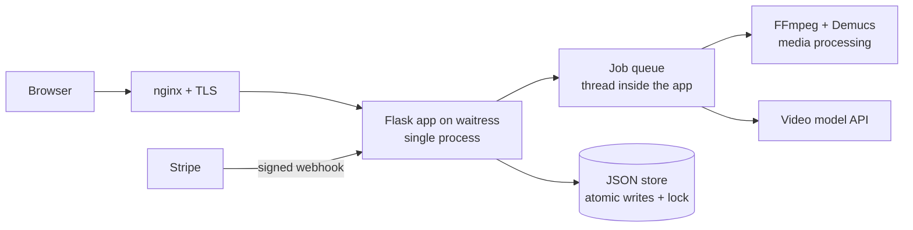

# TrocaTroca

Pay-per-second AI video service with an affiliate program.

Case study · Python · Flask · Stripe · OAuth · FFmpeg · Linux

## The problem

Users upload a short clip and get it back with the person replaced by one of a set of ready-made characters, generated by a video model through an API. Calling the model is the easy part. The engineering is everything around it: charging per second for a slow, paid, asynchronous job without ever charging twice, losing a payment or paying an affiliate twice.

## Architecture

## Engineering decisions

- **One process, on purpose.** The job queue is a thread inside a single waitress process. With several workers (`gunicorn -w N`) each process would start its own queue, and the same order could run twice and be paid twice to the model provider. Throughput is capped by this choice, and that is accepted at this stage.
- **Payments are claim-first.** The webhook checks an HMAC-SHA256 signature over the timestamp and the raw body, with a 300-second tolerance. Each checkout session or invoice is reserved before any credit is applied. If crediting fails, the reservation is released so Stripe's retry can succeed. Card, Pix and subscription renewals go through the same path.
- **Money is integer cents.** The price of a video comes from the model's per-second cost, a margin per resolution, coupon rules and a floor. The affiliate commission is a share of the profit. A house floor can lower the commission but never the other way round, and each video can produce at most one commission. The public earnings simulator calls these same functions, so what the page shows is what the ledger pays.

## How it stays up

- 32 unittest files covering payments, commissions, the queue, backups and the move to the server.
- An end-to-end launch test runs on the server with the real configuration, a copy of the data and the real FFmpeg and Demucs. Only the model provider is mocked, so the test costs nothing.
- The move from a local machine to the VPS was a single script. It waited for in-flight orders to finish, postponed itself if they did not, and rolled back on failure.
- On a shared VPS the app runs as its own Unix user inside a systemd slice with memory and CPU caps, with secrets in a mode-600 file and a nightly backup.

## Known limits

The single process caps how many videos run at once, and the JSON store only works because there is one writer. The next step is moving the queue to a separate worker and the data to a relational database, keeping the same claim-first payment logic.

## Stack

| Layer | Tech |
|---|---|
| App | Python 3, Flask, waitress, Jinja2, vanilla JS |
| Payments | Stripe Checkout, Billing Portal, webhooks (card, Pix, subscriptions) |
| Auth | Google OAuth 2.0 |
| Media | FFmpeg, Demucs, generative video model via API |
| Infra | nginx, systemd slices, Let's Encrypt, Ubuntu VPS |

Solo project.

Source code is private. Happy to walk through it in a call.

Product site: https://trocatroca.cloud
