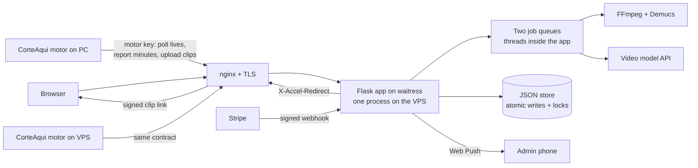

# TrocaTroca

Two video tools on one platform: swap a person or the scenery in a short clip, and cut clips from live streams automatically.

Case study · Python · Flask · Stripe · FFmpeg · nginx · Linux

## The problem

TrocaTroca started as one tool and became a platform with two. They share accounts, one credit ledger and one billing path.

**TrocaAqui** takes a short video, or a YouTube, Instagram or TikTok link, and returns it with the person or the scenery replaced by a video model API. The job is slow, paid and asynchronous. The work is in charging for it once, refunding it when it fails and surviving a restart in the middle.

**CorteAqui** records a live stream, transcribes it and cuts short clips while the stream runs. The work runs on engines called motors, one on a PC and one on a VPS, and each account is assigned one. The hard parts are allocating scarce recording slots, billing time that arrives as repeated reports, and serving large videos without loading the web process.

## Architecture

## Engineering decisions

- **One web process, on purpose.** The site runs as a single waitress process with two queue threads, so a swap waiting on the model never blocks shorter jobs. With several processes, each would start its own queues and the same order could run and be paid twice. Motors reach the site only over HTTPS, so the site stays the only writer of the data.
- **Motors pull and the site decides.** Each motor has its own key. The site returns only the lives assigned to that motor, and the worker checks the assignment again. The site ranks every live: paid customer, then customer, then courtesy account, then admin. The worker fills its slots with channels that are actually live, then by rank, and keeps the incumbent on a tie. An offline channel never takes a slot from a live one. When a customer arrives, a lower-ranked live gives up its slot.
- **Live billing is cumulative and idempotent.** The worker counts each recorded segment once and reports the session's total minutes. The site converts that into started blocks and charges only the difference from what the session has already paid, under a lock. A repeated report cannot charge twice. Paused time and time on another motor are not billed. When credits run out, the site stops the live and answers 402, and the worker stops recording.
- **nginx delivers the clips.** The site checks who may watch, then answers with an X-Accel-Redirect to an internal location, so the file never passes through Python or fills the service's memory cap. The studio panel plays clips from another origin without a session cookie. Each clip link carries an HMAC-SHA256 signature over owner, live, clip, file and timestamp, expires after 12 hours and is checked in constant time.
- **Payments are claim-first.** The Stripe webhook verifies the signature over the timestamp and raw body, with a 300-second tolerance. Each checkout session or invoice is reserved before credit is applied and released if crediting fails, so Stripe's retry can succeed. Pix arrives asynchronously and credits only on the paid status. Subscriptions are card only, because Stripe supports Pix in Brazil only for one-off payments.
- **"View as" is read-only.** An admin can open any account as its owner sees it. Any request that changes data returns 403, except stopping a live, and each visit is logged.

## How it stays up

- The site has 76 unittest files with 1,539 test functions, covering payments, credits, motors, slot priority, signed links, view-as and migrations. The worker side has 6 test scripts with 76 checks, including the full slot-allocation loop with the site and processes mocked.
- An end-to-end launch test runs on the server with the real configuration, a copy of the data and the real FFmpeg and Demucs. Only the model provider is mocked.
- Installing a server motor ends with a mandatory proof clip. If it fails, the install stops and the motor takes no lives.
- A restarted worker adopts the recorder and cutter already running, so a live does not pause, and waits for a clip in progress before replacing a cutter. One worker runs per data folder, three crashes in a row raise an alert, and lives stop before the disk fills.
- If the site restarts while the model is generating, the order returns to the queue and fetches its result. Other interrupted orders fail cleanly and refund their credits.
- The move to a new credit unit (x10) ran as a one-off script with a dry run, a backup and a resume that never doubles a migrated account.
- A nightly backup verifies each JSON file before archiving it, including the list of processed Stripe events, so a restore cannot credit a redelivered event twice.
- On a shared VPS the site runs as its own Unix user inside a systemd slice with memory and CPU caps. The server motor runs as user services, without root.
- Unhandled errors show a plain page and write the traceback to a rotating log. The contact form stores each message before notifying and allows three per IP per hour. Admin alerts use Web Push with encrypted payloads, sent off the request thread. Sign-up detects in-app browsers, where Google sign-in fails, and asks the user to open a real browser.

## Known limits

One process caps how many jobs run at once, and the JSON store depends on that single writer. The PC motor works only while the PC is on, and the site warns customers when it goes offline. The server motor has few slots, so priority decides who records under load. Live time is billed per started block, so a short session pays a full block. The contact rate limit lives in memory and resets on restart.

A future step is moving the queues to a separate worker and the data to a relational database, keeping claim-first payments and cumulative live billing.

## Stack

| Layer | Tech |
|---|---|
| App | Python 3, Flask, waitress, Jinja2, vanilla JS |
| Payments | Stripe Checkout, Billing Portal, webhooks (card, Pix, subscriptions) |
| Auth | Google OAuth 2.0, session cookies |
| Media | FFmpeg, Demucs, faster-whisper, OpenCV, yt-dlp, a video model API |
| Live motors | Python workers on a Windows PC and a Linux server |
| Notifications | Web Push (VAPID) |
| Infra | nginx (X-Accel-Redirect), systemd slices, timers and user services, Let's Encrypt, Ubuntu VPS |

Solo project.

Source code is private. Happy to walk through it in a call.

Product site: https://trocatroca.cloud
